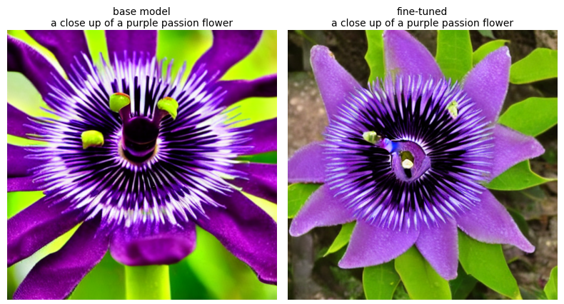

# 🎨 How These Projects Work

This page explains the ideas behind both projects: fine-tuning Stable Diffusion (sections 2 and 3), and building a diffusion model from scratch (section 4). Section 5 covers the app. For setup steps, see the [README](README.md).

## 🌫️ 1. Diffusion models and Stable Diffusion

### How a diffusion model works

A diffusion model learns to create images by learning to remove noise.

During training, a clean image is gradually covered with random noise until nothing recognisable is left, like a photo dissolving into TV static. The model's job is to look at a noisy image and work out which part of it is noise. To create a new image, the process runs in reverse: start from pure noise, and remove a little at a time until a picture appears.

### What Stable Diffusion adds

Working directly on full-size images is slow, so Stable Diffusion works on a small compressed version of the image instead. A text prompt then guides each step of noise removal. It has three parts:

| Part | What it does | Download size |
|---|---|---|
| Text encoder (CLIP) | Turns the prompt into numbers the model can use | 492 MB |
| U-Net | Predicts the noise at each step, guided by the prompt | 3.44 GB |
| VAE | Compresses a 512×512 image to 64×64, and expands it back at the end | 335 MB |

### Credit and sources

The models and datasets used here are the work of their authors, with thanks for making them available:

- **Model:** [Stable Diffusion 1.5](https://huggingface.co/stable-diffusion-v1-5/stable-diffusion-v1-5) by CompVis, Stability AI and Runway
- **Captions:** [BLIP](https://huggingface.co/Salesforce/blip-image-captioning-base) by Salesforce
- **Datasets:** [Oxford 102 Flowers](https://www.robots.ox.ac.uk/~vgg/data/flowers/102/) and [Caltech-UCSD Birds 200](https://www.vision.caltech.edu/datasets/cub_200_2011/)
- **Training code:** [Diffusers](https://github.com/huggingface/diffusers) by Hugging Face, for project 1
- **Project 2:** [Fashion-MNIST](https://github.com/zalandoresearch/fashion-mnist) by Zalando Research, [CLIP](https://huggingface.co/openai/clip-vit-base-patch32) by OpenAI, and the published methods DDPM (Ho et al.), DDIM (Song et al.) and classifier-free guidance (Ho and Salimans)

## 🔧 2. Fine-tuning Stable Diffusion

### The goal

Fine-tuning adapts a trained model using new examples, so it does not have to learn everything again. Here, the aim is to shift Stable Diffusion's images towards the look of a set of real flower or bird photos.

Fine-tuning is the usual choice because training a diffusion model from scratch takes millions of images and a large amount of GPU time, as the model must first learn what the visual world looks like. Fine-tuning reuses all of that knowledge, so a small dataset and a few minutes on a free GPU are enough to adjust its style, as this project's 200 images and 400 steps show.

### Why LoRA

Retraining the whole 3.44 GB U-Net would need far more time and memory than a free GPU offers. LoRA (Low-Rank Adaptation) leaves the original model unchanged and trains a small set of extra weights that sit alongside it.

The saving comes from replacing one large table of numbers with two thin ones. Take one attention layer in the U-Net, which has a table of 768 × 320 numbers:

| Approach | Numbers to train in this layer |
|---|---|
| Train the original table | 768 × 320 = 245,760 |
| Train two thin LoRA tables at rank 8 | 8 × (768 + 320) = 8,704 |

This is why the result here is a 6.1 MB file, not several gigabytes. A higher rank gives the LoRA more capacity, but makes the file larger.

### What is trained and what stays frozen

| Part | During training |
|---|---|
| Text encoder | Frozen |
| VAE | Frozen |
| U-Net | Frozen |
| LoRA weights on the U-Net's attention layers | Trained |

The attention layers are where the U-Net connects the image to the prompt, so a small change there can affect the style of the result. The second LoRA table starts at zero, which means that before training the LoRA has no effect at all, and the model behaves exactly like the original.

### Preparing the data

1. Download the chosen dataset and shuffle it, because its rows are sorted by species.
2. Keep 200 images with their captions for training, such as "a red geranium in the garden".
3. Set 6 more aside, so the image modes can be tried on images the model did not train on.
4. Save the training images to Colab's local disk, which is faster to read from than Google Drive.

### One training step

Each step teaches the LoRA a little, using one image and its caption:

```
image  → crop to 512×512, randomly flip → VAE compresses it to 64×64
caption → text encoder turns it into numbers
random noise, at a random strength → added to the compressed image
U-Net with LoRA → predicts the noise that was added, guided by the caption
compare predicted noise with the real noise → the difference is the loss
adjust only the LoRA weights to make that difference smaller
```

Because the noise strength is random, the model practises on images from nearly clean to almost pure static.

### Repeating it

The default run makes 400 steps over 200 images, so each image is seen about twice. Only one image is processed per step, and the learning rate gradually falls to zero, so the changes become smaller towards the end.

### The settings

| Setting | Value | What it controls |
|---|---|---|
| `NUM_IMAGES` | 200 | How many photos to learn from |
| `MAX_TRAIN_STEPS` | 400 | How long to train: more steps usually give a stronger effect |
| `LORA_RANK` | 8 | How much the LoRA can learn: a higher rank gives a larger file |
| `LEARNING_RATE` | 0.0001 | How large each adjustment is |
| Resolution | 512 | The image size the model was built for |
| Mixed precision | fp16 | Frozen parts use lower precision to save GPU memory, while the LoRA stays at full precision |

Three choices keep the run short: no sample images during training, no intermediate checkpoints, and images read from the local disk.

### a. Text to image (text2img)

You write a prompt, and the model draws a new image. This mode uses the fine-tuned LoRA.

1. The text encoder turns the prompt into numbers.
2. A 64×64 block of pure noise is created from the seed.
3. The U-Net and LoRA predict the noise and remove part of it. This repeats for 25 steps by default.
4. The VAE expands the result into a 512×512 image.

At each step the model makes two predictions, one with the prompt and one without, and moves further in the direction of the prompt. The guidance scale, 7.5 by default, sets how far. Higher values follow the prompt more closely, but can look less natural.

The same seed starts from the same noise, which is what makes a fair comparison between the base and fine-tuned models possible. On the T4, repeating a run with the same seed gave nearly identical images, though not an exact match pixel for pixel.

### b. Image to text (img2text)

You provide an image, and a model describes it in words. This mode does not use Stable Diffusion or the LoRA.

A diffusion model turns text into images and does not work in the other direction, so this mode uses BLIP, a separate model trained to describe images. BLIP is used as published and is not fine-tuned in this project.

1. An image encoder inside BLIP turns the picture into numbers.
2. A text decoder writes a caption one word at a time, up to a set limit.

Its captions are usually accurate but general: for example, "a yellow flower in the garden" for a black-eyed Susan. It describes what it sees, but does not always name the species.

### c. Image to image (img2img)

You provide an image and a prompt, and the model produces a changed version. This mode uses the fine-tuned LoRA.

It works like text to image, except that it starts from your image and not from pure noise:

1. The image is cropped to a 512×512 square, and the VAE compresses it.
2. Noise is added, and the strength setting decides how much.
3. The U-Net and LoRA remove the noise, guided by the prompt.
4. The VAE expands the result back into an image.

Strength decides how much of the original survives, and also how many steps run. With 25 steps and a strength of 0.6, the model runs 15 steps.

| Strength | Result |
|---|---|
| Low, such as 0.3 | Stays close to the original, with the prompt's style on top |
| Middle, such as 0.5 | Keeps the arrangement, with visible changes |
| High, such as 0.75 | Follows the prompt more freely, and details of the original are lost |

## 🚀 3. Training in Colab on a T4 GPU

Training runs in Google Colab, which offers a T4 GPU on its free tier. Availability varies with demand.

### Running the notebook

1. In [Google Colab](https://colab.research.google.com), choose *File → Upload notebook* and select `diffusion_model_finetuning.ipynb`.
2. Choose *Runtime → Change runtime type → T4 GPU*.
3. In the ⚙️ Settings cell, choose `flowers` or `birds`, and change any other settings you want.
4. Choose *Runtime → Run all*.
5. When asked, allow Google Drive access, using the same Google account as Colab and ticking every permission.

Keep the tab open while it runs, as Colab can disconnect an idle session.

### What each part does

These times are from one full run with the flowers dataset and the default settings. They include downloading the models, and will vary between sessions.

| Cell | What it does | Time |
|---|---|---|
| 📦 Install | Installs the libraries and downloads the training script | 10 seconds |
| 🔧 Setup | Checks the GPU, connects Google Drive and creates folders | 36 seconds, including the Drive permission step |
| 📚 Prepare | Downloads the dataset and saves the images and captions | 1 minute |
| 🚀 Train | Downloads Stable Diffusion and trains the LoRA | 4.5 minutes, of which training is 2 minutes 45 seconds |
| 💾 Save | Checks the weights and copies them to Drive | Under a second |
| 🖌️ Load | Loads Stable Diffusion with the LoRA | 24 seconds |
| ✍️ text2img | Draws three prompts with both models | 31 seconds |
| 🔁 img2img | Changes one image at three strengths | 9 seconds |
| 💬 img2text | Downloads BLIP and captions three images | 20 seconds |
| 🔗 All three | Runs the three modes one after another | 9 seconds |

The whole notebook took about 8 minutes.

### Reading the training output

While training runs, the output shows a progress line such as:

```
Steps: 100% 400/400 [02:45<00:00, 2.42it/s, lr=0, step_loss=0.00791]
```

| Part | Meaning |
|---|---|
| `400/400` | Steps finished, out of the total |
| `02:45<00:00` | Time taken, and the estimated time left |
| `2.42it/s` | Training speed in steps per second |
| `lr=0` | The current learning rate, which reaches zero by design at the last step |
| `step_loss` | The error on that one step. It jumps around with the random noise, so a single value does not show how good the model is |

### The result

The training produces a 6.1 MB file, `pytorch_lora_weights.safetensors`. It is copied to `MyDrive/diffusion_finetuning` in Google Drive, with the generated images in an `outputs` folder beside it.



*AI-generated images: the base model (left) and the fine-tuned model (right), from the same prompt and seed.*

The effect varies by prompt. The passion flower above moves from a saturated, artificial look to something closer to a garden photo, which is the clearest of the three comparisons. The rose and sunflower change only slightly. Stable Diffusion already knows flowers well, so a short LoRA run shifts its style and does not teach it a new subject.

### If something goes wrong

| What you see | What it means |
|---|---|
| `No GPU found` | The T4 is not selected: repeat step 2 and run again |
| `Google Drive not mounted` | Drive refused the connection. The run continues, but nothing is backed up, so download the weights from Colab's Files panel at `/content/diffusion_finetuning/lora/` before closing |
| Colab says no GPU is available | The free tier is busy or your usage limit was reached: try again later |
| The effect is too subtle | Raise `MAX_TRAIN_STEPS`, for example to 1000 (about 7 minutes of training), or `LORA_RANK`, for example to 16 |

## 🔬 4. Diffusion from scratch

### The goal

Project 1 adapts a model that already knows how to draw. This project starts from a model that knows nothing, with random weights, and trains it, so every part of a diffusion model can be seen working. To make that possible in minutes on a free GPU, the images are tiny: Fashion-MNIST, 28×28 greyscale pictures of clothing in 10 categories.

### What is built here and what is reused

| Part | Built here or reused |
|---|---|
| Noise schedule | Built here |
| U-Net, about 2.9 million numbers | Built here, and trained from random weights |
| Sampler, with guidance | Built here |
| Text encoder (CLIP) | Reused from OpenAI, and frozen |

The U-Net is about 300 times smaller than Stable Diffusion's, which has about 860 million numbers.

### Turning prompts into numbers

CLIP turns each prompt into 512 numbers. Each category has a few words and six sentence patterns, which make 150 training prompts, such as "a picture of a jumper" for a pullover. Each training image is paired with a random wording of its category, so the model learns to accept different phrasing.

The test prompts, such as "a white running shoe", use wordings that never appear in training, so the results show whether the model copes with new phrasing.

### The noise schedule

There are 1,000 noise levels, from almost clean to pure noise. Any level can be reached in one step, by mixing the clean image and random noise in proportions set by the schedule. This is what makes training fast: there is no need to add noise a little at a time.

### The U-Net

The U-Net shrinks the image from 28×28 to 14×14 to 7×7 and back, with shortcuts between matching sizes so fine detail is not lost. At 7×7, an attention layer lets every part of the image affect every other part. The noise level and the prompt are added into every block, which is how they steer the result.

### One training step

```
128 images → a random noise level for each → add that much noise
each image's category → a random wording → CLIP's numbers (or "no prompt" for one image in ten)
U-Net → predicts the noise from the noisy image, the noise level and the prompt
compare predicted noise with the real noise → the difference is the loss
adjust all of the U-Net's weights to make that difference smaller
```

The default run makes 20 passes over the 60,000 training images, about 9,400 steps. The images without a prompt teach the model to draw without one, which guidance needs.

A smoothed copy of the weights (an exponential moving average) is kept alongside the model and used for drawing, because it gives cleaner images than the weights at any single step.

### Drawing an image

The sampler starts from pure noise and removes it in 50 steps, using a method called DDIM, which skips most of the 1,000 levels. At each step it predicts the noise twice, with and without the prompt, and moves further in the prompt's direction. This is classifier-free guidance, the same idea as in Stable Diffusion. Its default here is 3.0. In the full run, guidance 0 drew random clothing for the prompt "an elegant evening dress", 1 drew mostly dresses, and 3 and 7 drew dresses every time, with 7 looking much like 3.

### Checking that the text works

A separate small classifier is trained on the real images. It then judges what each generated image shows, and the notebook reports how often that matches the prompt. The same is measured with guidance 0, where the prompt is ignored, so matches are down to chance, about 10%. The gap between the two shows how much the text steers the model.

The classifier is not perfect on real images either, and the notebook prints its accuracy for comparison. In the full run:

| Measure | Result |
|---|---|
| Generated images matching their prompt, with guidance 3.0 | 98% on average, from 85% to 100% per prompt |
| The same with guidance 0 | 11% |
| Classifier accuracy on real test images | 88.8% |

The match rate is higher than the classifier's accuracy on real images, most likely because the generated images are clear, typical examples of each category, while the real test set includes harder cases. The weakest prompt was "a collared shirt", at 85%, as shirts look similar to T-shirts, pullovers and coats at this size.

### Recognising prompts it does not know

The notebook compares each prompt's numbers with the average for each category. A prompt is drawn only if it is close enough to one of them, with the threshold set halfway between the weakest new wording and the strongest off-topic prompt.

In the quick check, the weakest new wording, "an elegant evening dress", scored 0.878, and "a cat" scored 0.854, with the threshold at 0.866. These scores come from CLIP alone, so they do not depend on training. The gap is small, so the check works for clear cases such as "a cat", but prompts near the threshold can be misjudged either way.

### Training in Colab

1. Upload `diffusion_from_scratch/text_to_image_diffusion_from_scratch.ipynb` to Colab, and choose *Runtime → Change runtime type → T4 GPU*.
2. For a first test, tick `QUICK_CHECK` in the ⚙️ Settings cell, and choose *Runtime → Run all*. It trains for one short epoch, so every cell runs in a few minutes, but the images stay noisy.
3. Untick `QUICK_CHECK`, and choose *Runtime → Run all* again for the full run.

On a T4, the quick check ran without errors, and the full run took about 12 minutes in total, of which training took 9.5 minutes at about 16 steps per second. The first epoch is slower while the GPU warms up. After every epoch, the training cell prints the speed and the time left. The trained model, `diffusion_from_scratch.pt`, is about 11 MB and is copied to `MyDrive/diffusion_from_scratch` in Google Drive.

### How this differs from other Fashion-MNIST examples

Small diffusion models on MNIST and Fashion-MNIST are a common learning exercise, and many public examples train one with category numbers and guidance. This project follows the same published methods. What it adds is modest: prompts in words through CLIP, with several wordings per category; a test on wordings never used in training; a match score against a "prompt ignored" baseline; a check that declines prompts outside the categories; and the model's use in an app.

## 🖥️ 5. Using the application and inferencing

Inference means using a model that has already been trained. No training happens in the app: it loads the trained models and uses them to produce results. The sidebar's **Model** choice switches between fine-tuned Stable Diffusion, with its three modes, and the from-scratch model, which offers text to image only. The app uses the DPM-Solver++ scheduler, which gives cleaner images at low step counts, so its images differ slightly from the notebook's, even with the same seed.

### Setting it up

1. Install the libraries:
   ```
   pip install -r requirements.txt
   ```
2. Download your trained models from Google Drive, and save them in the repo:

   | From Google Drive | Save as |
   |---|---|
   | `MyDrive/diffusion_finetuning/pytorch_lora_weights.safetensors` | `weights/pytorch_lora_weights.safetensors` |
   | `MyDrive/diffusion_from_scratch/diffusion_from_scratch.pt` | `weights/diffusion_from_scratch.pt` |

3. Start the app:
   ```
   streamlit run app.py
   ```

The weights are not included in this repo, so they come from your own training runs in sections 3 and 4. Without the first file, the app shows a notice and uses the base Stable Diffusion model. Without the second, the from-scratch model cannot be used. The first use downloads about 4 GB for Stable Diffusion, about 1 GB for BLIP and about 600 MB for CLIP.

A GPU is recommended, because image generation is far slower without one:

| Task | T4 GPU | 8-thread laptop CPU |
|---|---|---|
| One image at 25 steps | About 5 seconds | About 9 minutes |
| One image at 10 steps | Not measured | About 3.5 minutes |
| One caption | Not measured | About 5 seconds |
| Eight from-scratch images at 50 steps | Under a second, after about 35 seconds to load the model and CLIP the first time | About 4 seconds, after about 40 seconds to load them the first time |

### Choosing a mode

| Mode | Choose an input | Button | Result |
|---|---|---|---|
| Text to image | A sample prompt, or write your own | Generate image | An image to view and download |
| Image to text | A sample image, or upload your own | Describe image | A caption |
| Image to image | An image, a prompt and a strength | Change image | An image to view and download |
| From scratch: text to image | A sample prompt, or write your own | Generate images | A grid of 28×28 images, enlarged, to view and download. A prompt outside the 10 categories is reported instead of drawn |

### Sample inputs

The `test` folder holds samples, so you can try the app straight away. They appear in the app's lists, next to the options to write your own text or upload your own image.

| Path | Contents |
|---|---|
| `test/images/` | Passion flower, pink water lily, red rose, small blue bird, sunflower field and white daisies |
| `test/text2img_prompts.txt` | Prompts for text to image |
| `test/img2img_prompts.txt` | Prompts for image to image |
| `test/from_scratch_prompts.txt` | Prompts for the from-scratch model, ending with "a cat" to show a prompt it declines |

The images in `test/images/` are AI-generated: they were created with Stable Diffusion 1.5 and the LoRA from this project, and are not photographs. Uploaded images can be PNG, JPG or WebP, and are cropped to a square for image to image.

### The settings

These are in the sidebar. For Stable Diffusion:

| Setting | Default | What it changes |
|---|---|---|
| Inference steps | 25 with a GPU, 10 on a CPU | More steps can add detail, but take longer |
| Guidance scale | 7.5 | How closely the image follows the prompt |
| Seed | 1337 | The starting noise: keep it the same to compare results, or change it for a different image |
| Also draw with the base model | On with a GPU, off on a CPU | Draws a second image from the same seed for comparison, which doubles the time |

For the from-scratch model:

| Setting | Default | What it changes |
|---|---|---|
| Sampling steps | 50 | More steps can add detail, but take longer |
| Guidance scale | 3.0 | How closely the images follow the prompt: 0 ignores it |
| Seed | 1337 | The starting noise |
| Number of images | 8 | How many images to draw for the prompt |

The sidebar also shows the device in use, and whether each model's weights were found.

### If something goes wrong

| What you see | What to do |
|---|---|
| "Fine-tuned weights not found" | Check the file is saved as `weights/pytorch_lora_weights.safetensors` |
| "From-scratch weights not found" | Check the file is saved as `weights/diffusion_from_scratch.pt` |
| Images take several minutes | This is expected on a CPU, which the sidebar will show. Lower the inference steps, or use a GPU |
| `Found an incompatible version of torchao` | Run `pip uninstall torchao`: the app does not use it, and PEFT will not run with an old version |

### Responsible use

The app is set up for use on your own computer: `.streamlit/config.toml` makes it reachable only from that computer, and it has no login. It limits uploads to 10 MB. Stable Diffusion, the LoRA and BLIP are loaded only from the safetensors format, which cannot run code when loaded. CLIP is published only in PyTorch's older format, and the from-scratch model is saved in it, so both are loaded in PyTorch's weights-only mode, which refuses anything except numbers and plain values.

The notebook and app load Stable Diffusion without its optional safety checker, which is intended for private use. Add a login and suitable content filtering before hosting the app for other people. Use of the model must follow the restrictions in its [CreativeML OpenRAIL-M licence](https://huggingface.co/stable-diffusion-v1-5/stable-diffusion-v1-5), and it is good practice to label generated images as AI-generated when you share them.
