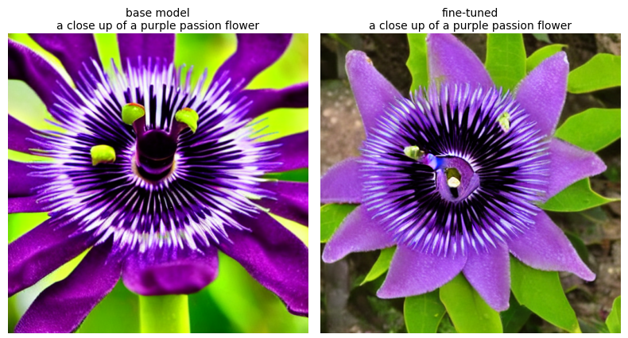
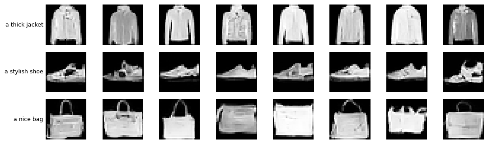

# 🎨 Diffusion Models: Image Generation and Captioning

Two projects with diffusion models: one fine-tunes Stable Diffusion for text to image and image to image, with image to text from a separate caption model, and one builds and trains a small text-to-image model from scratch. Both run in Google Colab on a free T4 GPU, and both can be used in one Streamlit app.

| Project | What it does | Where |
|---|---|---|
| 🌸 **Fine-tuned Stable Diffusion** | Fine-tunes Stable Diffusion 1.5 on flower or bird photos with LoRA, for text2img, img2img and img2text | `diffusion_model_finetuning.ipynb` |
| 🔬 **Diffusion from scratch** | Trains a small text-to-image diffusion model from random weights on Fashion-MNIST clothing images | `diffusion_from_scratch/` |

For how both work, explained step by step, see [DETAILS.md](DETAILS.md).

## 📁 Files

| File | What it is |
|---|---|
| 📓&nbsp;`diffusion_model_finetuning.ipynb` | Project 1's Colab notebook: data, training, and all three modes, with the outputs of a T4 run |
| 🔬&nbsp;`diffusion_from_scratch/` | Project 2: its Colab notebook, and the same model code as a module for the app |
| 📖&nbsp;`DETAILS.md` | How diffusion models, both projects and the app work |
| 🖥️&nbsp;`app.py` | A Streamlit app for both projects |
| 📦&nbsp;`requirements.txt` | The libraries the app needs |
| 🔒&nbsp;`.streamlit/config.toml` | Keeps the app reachable only from your own computer |
| 🧪&nbsp;`test/` | Sample prompts and AI-generated sample images for the app |
| 🖼️&nbsp;`assets/` | The AI-generated sample results shown below |

Datasets and models are downloaded at run time. Trained weights are saved to Google Drive, not to this repository.

## 🌸 Project 1: Fine-tuned Stable Diffusion

Fine-tunes Stable Diffusion 1.5 on a small set of flower or bird photos using LoRA in Google Colab, then uses the result to create images from text, change existing images, and describe images in words.

| Mode | Input → output | Model doing the work |
|---|---|---|
| ✍️ **text2img** | prompt → new image | Stable Diffusion 1.5 + the fine-tuned LoRA |
| 🔁 **img2img** | image + prompt → changed image | Stable Diffusion 1.5 + the fine-tuned LoRA |
| 💬 **img2text** | image → caption | BLIP, a separate caption model |

> 🌱 NOTE: A diffusion model turns text into images, not the other way round, so img2text uses BLIP. BLIP is not fine-tuned here and the LoRA does not affect it.

### Train the model

Training runs in Google Colab on a free T4 GPU, so it needs only a Google account and a browser.

1. In [Google Colab](https://colab.research.google.com), choose *File → Upload notebook* and select `diffusion_model_finetuning.ipynb`.
2. Choose *Runtime → Change runtime type → T4 GPU*.
3. In the ⚙️ Settings cell, choose `flowers` or `birds`.
4. Choose *Runtime → Run all*.
5. When asked, allow Google Drive access, using the same Google account as Colab and ticking every permission.

With the default settings (200 images, 400 steps), the whole notebook takes about 8 minutes, of which about 3 minutes is training. Keep the tab open while it runs.

The trained model is one 6 MB file, `pytorch_lora_weights.safetensors`, saved to `MyDrive/diffusion_finetuning` in Google Drive. If Drive could not connect, the notebook still finishes: download the file from Colab's Files panel, at `/content/diffusion_finetuning/lora/`, before closing the tab.

### Sample result



From a T4 run with the default settings on the flowers dataset, using the same prompt and random seed. This is the clearest of the three text2img comparisons in that run: the rose and sunflower changed less.

### How the fine-tuning works

A LoRA trains a small set of extra weights (a few MB) on top of the unchanged 4 GB base model. Each training step takes one image and its caption, adds random noise, and asks the model to predict that noise. Only the LoRA weights are updated.

Three choices keep training short: no validation images during training, no intermediate checkpoints, and training images read from the local disk instead of Google Drive.

### Notes

- Stable Diffusion already knows flowers and birds well, so the LoRA shifts images towards the look of the training photos rather than creating a completely different picture. The text2img cell shows the base and fine-tuned models side by side, from the same random seed, so the difference is easy to compare.
- A stronger effect takes more training: raise `MAX_TRAIN_STEPS` or `LORA_RANK` in Settings.
- The Diffusers library and its training script are pinned to the same version (0.42.1), because the script refuses to run against a different one.

## 🔬 Project 2: Diffusion from scratch

Builds a small text-to-image diffusion model and trains it from random weights on Fashion-MNIST: 70,000 greyscale clothing images of 28×28 pixels, in 10 categories. No pre-trained image model is used: the noise schedule, the U-Net, the training loop and the sampler are written in PyTorch in the notebook. Prompts are turned into numbers by CLIP, a pre-trained text encoder that stays frozen.

| What it can do | What it cannot do |
|---|---|
| Draw the 10 categories, such as a jacket, a sneaker or a bag | Draw anything outside those categories, such as a cat |
| Accept different wordings, such as "a sneaker" or "a white running shoe" | Follow details such as colour, patterns or several objects |
| Decline prompts clearly outside its categories, such as "a cat" | Judge prompts near the threshold reliably, as the check is approximate |

### Train the model

1. In [Google Colab](https://colab.research.google.com), choose *File → Upload notebook* and select `diffusion_from_scratch/text_to_image_diffusion_from_scratch.ipynb`.
2. Choose *Runtime → Change runtime type → T4 GPU*.
3. For a first test, tick `QUICK_CHECK` in the ⚙️ Settings cell. Every cell then runs in a few minutes, but the images stay noisy.
4. Choose *Runtime → Run all*, and allow Google Drive access when asked.
5. For the real run, untick `QUICK_CHECK` and choose *Runtime → Run all* again.

In a full run on a T4, the whole notebook took about 12 minutes, of which training took 9.5 minutes at about 16 steps per second. After every epoch, the training cell prints the speed and the time left.

The trained model is one file of about 11 MB, `diffusion_from_scratch.pt`, saved to `MyDrive/diffusion_from_scratch` in Google Drive.

### Results

From one full run on a T4, with the default settings. Every test prompt used wording that never appeared in training.

| Measure | Result |
|---|---|
| Images that a separate classifier judged to match their prompt, with guidance 3.0 | 98% on average, from 85% to 100% per prompt |
| The same with guidance 0, where the prompt is ignored | 11%, close to the 10% expected by chance |
| The classifier's accuracy on real test images, for comparison | 88.8% |



*AI-generated images from the model trained from scratch, for three prompts worded differently from any used in training.*

The gap between 98% and 11% shows that the text prompt controls what is drawn. The match rate is higher than the classifier's accuracy on real images, most likely because the generated images are clear, typical examples of each category, while the real test set includes harder cases. The weakest prompt was "a collared shirt", at 85%: shirts look similar to T-shirts, pullovers and coats at 28×28.

### What the notebook shows

- A grid of images for prompts worded differently from any used in training
- How often the images match their prompt, measured by a separate classifier, compared with guidance 0, where the prompt is ignored
- One image forming from noise, step by step
- The same prompt at four guidance scales
- A cell for your own prompts, which reports prompts outside the 10 categories instead of drawing them

## 🖥️ Run the app

The app has a choice of model in its sidebar:

| Model | Modes |
|---|---|
| Fine-tuned Stable Diffusion | Text to image, image to text and image to image |
| From scratch (Fashion-MNIST) | Text to image |

Each mode can use the samples in `test/` or your own text and images, and generated images can be downloaded. The app needs Python 3.11 and about 9 GB of free disk space.

### 1. Get the code and create a virtual environment

```
git clone https://github.com/laurelthejas/diffusion-models-image-generation-and-captioning.git
cd diffusion-models-image-generation-and-captioning
python -m venv .venv
```

### 2. Activate the environment and install the libraries

| System | Activate |
|---|---|
| Windows | `.venv\Scripts\activate` |
| macOS or Linux | `source .venv/bin/activate` |

If Windows PowerShell says that running scripts is disabled, run this first. It applies only to the current terminal window:

```
Set-ExecutionPolicy -Scope Process RemoteSigned
```

Then install the libraries:

```
pip install -r requirements.txt
```

### 3. Add your trained models

Download the files your training runs saved to Google Drive, and put them in the repo's `weights/` folder:

| Model | Download from Google Drive | Save in the repo as |
|---|---|---|
| Fine-tuned Stable Diffusion | `MyDrive/diffusion_finetuning/pytorch_lora_weights.safetensors` | `weights/pytorch_lora_weights.safetensors` |
| From scratch | `MyDrive/diffusion_from_scratch/diffusion_from_scratch.pt` | `weights/diffusion_from_scratch.pt` |

Without the first file, the app uses the base Stable Diffusion model. Without the second, the from-scratch model cannot be used. The `weights/` folder is ignored by git.

### 4. Start the app

```
streamlit run app.py
```

Run this from the repo folder, then open the link it prints, http://127.0.0.1:8501. The sidebar shows whether each model's weights were found. The first use downloads about 4 GB for Stable Diffusion, about 1 GB for BLIP and about 600 MB for CLIP.

To stop the app, press `Ctrl+C` in the terminal. To start it again later, activate the environment and repeat this step. On Windows, `.venv\Scripts\streamlit run app.py` also starts it without activating.

### Settings

| Setting | What it does |
|---|---|
| Model | Which project's model to use |
| Inference steps or sampling steps | How many times noise is removed: more can add detail, but takes longer |
| Guidance scale | How closely the image follows your prompt |
| Seed | The starting noise: the same seed repeats an image, and a new one gives a new image |
| Also draw with the base model | Adds an image without fine-tuning, for comparison, and doubles the time (Stable Diffusion only) |
| Strength (image to image only) | How much the image can change: low stays close to the original, high follows the prompt |
| Number of images (from scratch only) | How many images to draw for the prompt |
| Device | What is doing the work: a GPU is far faster than a CPU |
| Weights | Whether each trained model was found |

### How long it takes

| Task | T4 GPU | 8-thread laptop CPU |
|---|---|---|
| One Stable Diffusion image at 25 steps | About 5 seconds | About 9 minutes |
| One Stable Diffusion image at 10 steps, the default on a CPU | Not measured | About 3–4 minutes |
| One caption | Not measured | About 5 seconds |
| Eight from-scratch images at 50 steps | Under a second, after about 35 seconds to load the model and CLIP the first time | About 4 seconds, after about 40 seconds to load them the first time |

The Stable Diffusion T4 figure comes from the notebook, because that part of the app has so far been run on a CPU only. The from-scratch T4 figure comes from running the app's code in Colab. To use an NVIDIA GPU on Windows, first install a CUDA build of PyTorch 2.15.0 by following [pytorch.org](https://pytorch.org/get-started/locally/).

For the settings and for troubleshooting, see [DETAILS.md](DETAILS.md).

## 🧪 Test samples

| Path | What it is |
|---|---|
| `test/images/` | Six AI-generated images, not photographs |
| `test/text2img_prompts.txt` | Sample prompts for Stable Diffusion text to image |
| `test/img2img_prompts.txt` | Sample prompts for image to image |
| `test/from_scratch_prompts.txt` | Sample prompts for the from-scratch model, including one outside its categories |

> 🤖 AI-GENERATED: The images in `test/images/` and `assets/passion_flower_base_vs_finetuned.png` were created with Stable Diffusion 1.5 and the LoRA fine-tuned in this project, and `assets/from_scratch_jacket_shoe_bag.png` with the model trained from scratch. They do not show real plants, animals, places or products.

## 📚 Datasets

| Project | Dataset | Images | Example caption or category |
|---|---|---|---|
| 1, `flowers` | [pranked03/flowers-blip-captions](https://huggingface.co/datasets/pranked03/flowers-blip-captions) (Oxford 102 Flowers) | 6,552 | "a close up of a passion flower" |
| 1, `birds` | [anjunhu/naively_captioned_CUB2002011_train](https://huggingface.co/datasets/anjunhu/naively_captioned_CUB2002011_train) (Caltech-UCSD Birds 200) | 5,994 | "A photo of a house sparrow" |
| 2 | [Fashion-MNIST](https://github.com/zalandoresearch/fashion-mnist) by Zalando Research | 70,000 | Sneaker |

Project 1 uses a random 200 images by default, plus 6 more held out of training for img2img and img2text. Project 2 uses all 60,000 training images, and the 10,000 test images to check its match score.

## ⚖️ License

MIT: see [LICENSE](LICENSE). The code in this repository is MIT licensed; the models and datasets are downloaded at runtime and keep their own terms: [Stable Diffusion 1.5](https://huggingface.co/stable-diffusion-v1-5/stable-diffusion-v1-5) (CreativeML OpenRAIL-M), [BLIP](https://huggingface.co/Salesforce/blip-image-captioning-base) (BSD-3-Clause), [CLIP](https://huggingface.co/openai/clip-vit-base-patch32) (released by OpenAI under MIT, and described in its model card as a research model), [Fashion-MNIST](https://github.com/zalandoresearch/fashion-mnist) (MIT), and the original terms of the Oxford 102 Flowers and Caltech-UCSD Birds image collections, which are published for research use. These photos are not stored in this repository: the notebook's saved outputs leave out the figures that display them.
